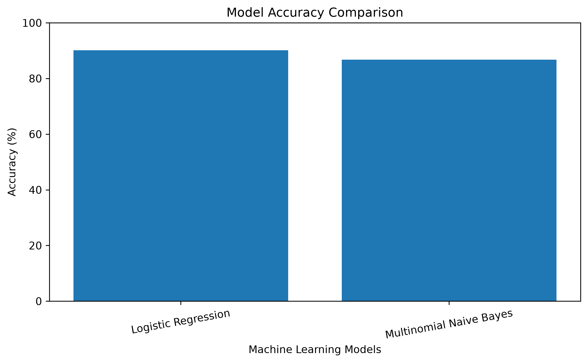
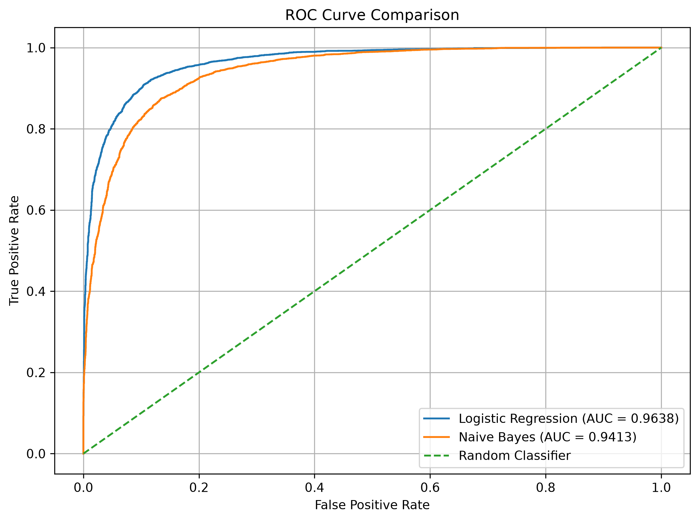
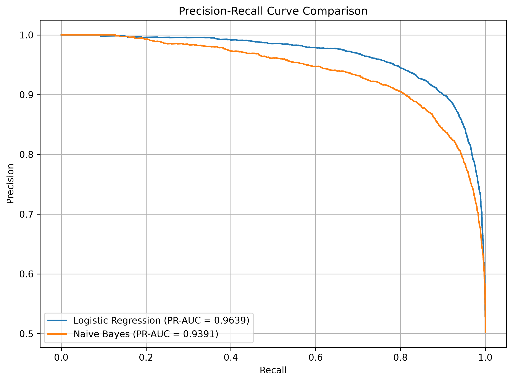
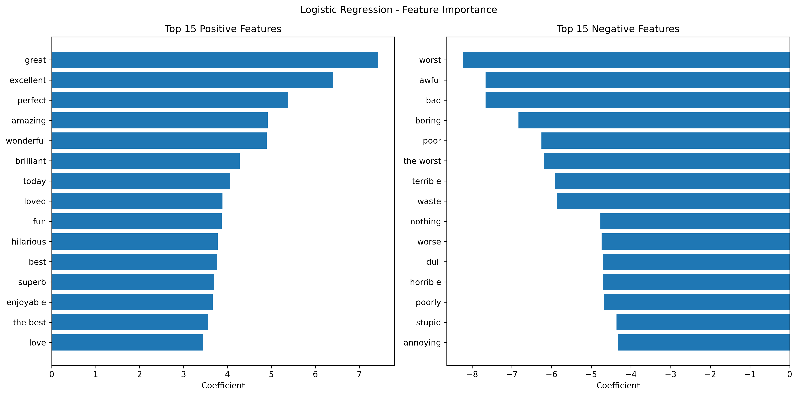

# Sentiment Analysis Using NLP

This is a machine learning project I built to classify IMDb movie reviews as **Positive** or **Negative** using Natural Language Processing (NLP).

I worked with the IMDb 50K Movie Reviews dataset, cleaned the review text, converted it into numerical features using TF-IDF, and trained machine learning models to predict sentiment.

## Project Overview

The main goal of this project was to understand how machine learning can be used to identify sentiment in text.

I experimented with two classification algorithms, Logistic Regression and Multinomial Naive Bayes, and compared their results to find the better-performing model.

## Technologies Used

- Python
- Pandas and NumPy
- Scikit-learn
- NLTK
- Matplotlib and Seaborn
- Jupyter Notebook
- Joblib

## Dataset

**IMDb 50K Movie Reviews Dataset**

[Kaggle Dataset](https://www.kaggle.com/datasets/lakshmi25npathi/imdb-dataset-of-50k-movie-reviews)

The dataset contains 50,000 movie reviews labelled as positive or negative.

After checking the data and removing duplicate rows, I worked with:

- Original reviews: 50,000
- Duplicate rows removed: 418
- Final reviews: 49,582
- Positive reviews: 24,884
- Negative reviews: 24,698

The dataset is not included in this repository. Download it from Kaggle and place `IMDB Dataset.csv` inside the `data/` folder.

## Project Workflow

Here are the main steps I followed while building this project:

1. **Exploratory Data Analysis (EDA)** – Checked the dataset, missing values, duplicates and sentiment distribution.
2. **Text Preprocessing**
   - Removed HTML tags.
   - Converted reviews to lowercase.
   - Removed special characters.
   - Cleaned extra spaces.
3. **TF-IDF Vectorization** – Converted the cleaned reviews into numerical features using unigrams and bigrams.
4. **Train-Test Split** – Divided the dataset into 80% training data and 20% testing data.
5. **Model Training** – Trained Logistic Regression and Multinomial Naive Bayes.
6. **Model Evaluation** – Compared both models using different evaluation metrics.
7. **Feature Analysis** – Checked which words had stronger positive and negative associations.
8. **Model Saving** – Saved the trained model and TF-IDF vectorizer using Joblib.
9. **Prediction** – Created a Python script to test the model with new movie reviews.

## Model Performance

I tested both models using 9,917 reviews that were not used during training.

| Metric | Logistic Regression | Multinomial Naive Bayes |
|---|---:|---:|
| Accuracy | 90.16% | 86.77% |
| Weighted F1-score | 90.16% | 86.77% |
| ROC-AUC | 96.38% | 94.13% |
| PR-AUC | 96.39% | 93.91% |

After comparing the results, I selected **Logistic Regression** as the final model because it performed better across all the metrics listed above.

## Visualizations

I created the following graphs to compare the models and understand their performance.

### Model Comparison



### ROC Curve



### Precision-Recall Curve



### Feature Importance



## Run the Project Locally

Want to try the project on your machine? Follow these steps.

### 1. Clone the repository

```bash
git clone https://github.com/bharghavguru/Sentiment-Analysis-Using-NLP.git
cd Sentiment-Analysis-Using-NLP
```

### 2. Create a virtual environment

```bash
python -m venv venv
```

### 3. Activate the environment

For Windows PowerShell:

```powershell
.\venv\Scripts\Activate.ps1
```

### 4. Install the required packages

```bash
pip install -r requirements.txt
```

### 5. Run the prediction program

```bash
python predict.py
```

Enter any movie review when the program asks for it. The model will predict whether the review is positive or negative and display its estimated confidence.

## Example Prediction

**Input:**

```text
The movie was fantastic. The acting was brilliant and the story was amazing.
```

**Output:**

```text
Sentiment: POSITIVE
Model confidence: 95.68%
```

## Repository Structure

```text
Sentiment-Analysis-Using-NLP/
│
├── data/
│   └── IMDB Dataset.csv
│
├── models/
│   ├── best_sentiment_model.pkl
│   └── tfidf_vectorizer.pkl
│
├── notebooks/
│   ├── 01_exploratory_data_analysis.ipynb
│   ├── 02_text_preprocessing.ipynb
│   └── 03_tfidf_vectorization.ipynb
│
├── reports/
│   └── figures/
│       ├── model_comparison.png
│       ├── roc_curve_comparison.png
│       ├── precision_recall_curve.png
│       └── feature_importance.png
│
├── predict.py
├── requirements.txt
├── .gitignore
└── README.md
```

## Limitations

- The model predicts only positive or negative sentiment. It does not identify neutral reviews.
- It uses TF-IDF and traditional machine learning algorithms rather than deep learning models.
- The confidence score is the model's estimated probability and does not guarantee that every prediction is correct.

## Future Improvements

- Experiment with LSTM and BERT models.
- Try different text preprocessing techniques.
- Explore hyperparameter tuning to improve model performance.
- Extend the project to support neutral sentiment.

## Author

**GitHub:** [bharghavguru](https://github.com/bharghavguru)